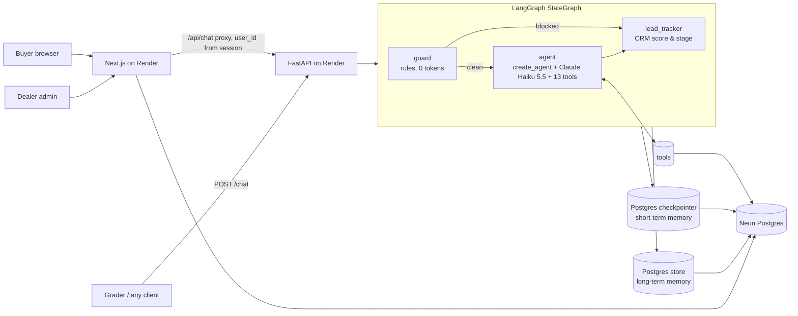

# DealCloser: a 24/7 AI sales rep for car dealerships

**Ava** answers buyers on a dealer's website any time of day. She qualifies them, searches live inventory, estimates payments and trade-ins, and books test drives (asking the buyer to confirm first). Every conversation becomes a scored lead in the dealer's dashboard. Demo dealer: **Apex Motors**.

| | |
|---|---|
| Live website | **https://dealcloser.onrender.com** (admin demo login: `admin@apexmotors.demo` / `12345`) |
| Agent API | **https://dealcloser-api.onrender.com**: `POST /chat`, `GET /health`, docs at [`/docs`](https://dealcloser-api.onrender.com/docs) |
| Demo video | `<VIDEO_URL>` |
| Hosting note | Both services run on Render's free plan and are kept warm by a 10-minute keepalive. If one has been idle, the first request can take ~50 s while it wakes. |
| Track | **DealCloser**, plus a bonus **GrowthPilot** integration (AI follow-up drafting for quiet leads) |

## Problem and business case
- Small and independent dealers lose leads that arrive after hours and on weekends. Buyers message three dealers and buy from whichever replies first.
- Sales staff spend hours answering the same price, availability and financing questions, and still miss test-drive bookings.
- **DealCloser** answers in seconds, 24/7, with live inventory data. It books test drives only after the buyer confirms and hands the dealer a ranked pipeline of qualified leads.
- **Pricing:** $79/month per dealership + $5 per attended test drive. **LLM cost is under $0.01 per conversation** (Claude Haiku 5.5; guard refusals and confirmations cost 0 tokens).

## Architecture



### Nodes
| Node | Kind | Job | LLM calls |
|---|---|---|---|
| `guard` | function | Rule-based safety on the incoming message: prompt injection (incl. leetspeak and multilingual), off-topic, fraud, requests for other users' data. Blocks with a fixed reply | 0 |
| `agent` | `create_agent` subgraph | The sales conversation: Claude Haiku 5.5 with 13 tools and middleware | 1-6 |
| `lead_tracker` | function | Deterministic CRM update: message count, lead score (0-100), stage (new → engaged → qualified → visit_booked) | 0 |

### Agent middleware (in order)
1. `memory_prompt` (`@dynamic_prompt`): fixed, cacheable sales prompt + dealer clock + `<buyer_memory>` loaded from the long-term store
2. `trim_history` (`@wrap_model_call`): only the last 24 messages go to the model, cut at a human turn so a tool call is never separated from its result
3. `HumanInTheLoopMiddleware`: pauses `book_test_drive`, `cancel_test_drive` and `forget_me` until the buyer says "yes"
4. `ModelCallLimitMiddleware(6)` and `ToolCallLimitMiddleware(8)`: no runaway loops
5. `tool_errors` (`@wrap_tool_call`): a failing tool becomes an `ERROR:` message the model can recover from
6. `output_guard` (`@after_model`): replaces any reply that leaks the system prompt (canary + 12-word overlap check)
7. `AnthropicPromptCachingMiddleware`: tools + fixed prompt are cached

### Tools (13)
| Tool | Purpose | Confirm? |
|---|---|---|
| `search_inventory` | Filter available cars by budget, body, seats, fuel, make, year, mileage; loosens the budget step by step if nothing matches (never seats or fuel) | |
| `get_vehicle_details` | Full specs, features, status (incl. reserved/sold), est. monthly payment; records "recently viewed" | |
| `compare_vehicles` | 2-3 cars side by side with the cheapest, lowest-mileage and most-seats picks | |
| `estimate_financing` | Amortised monthly payment and total interest (same formula as the website calculator) | |
| `estimate_trade_in` | Deterministic depreciation/mileage/condition model → value range; saved to the profile | |
| `check_test_drive_slots` | Free hourly slots, Mon-Sat 10-17, next 14 days, dealer timezone | |
| `book_test_drive` | Re-validates the slot in a transaction (unique index prevents double booking), max 3 upcoming | **yes** |
| `cancel_test_drive` | Ownership-checked cancel (the same "not found" reply for other users' bookings) | **yes** |
| `my_test_drives` | The buyer's own bookings only | |
| `save_buyer_profile` | Long-term memory write path (validated; notes that look like instructions are dropped) | |
| `dealer_info` | Hours, location, warranty, returns, documents, financing partners, trade-in process, test-drive rules | |
| `request_callback` | Human handoff for discounts, negotiation or complaints | |
| `forget_me` | Deletes the buyer's long-term memory | **yes** |

`user_id` is **never** a tool argument: tools read it from the server-side runtime context.

### Human-in-the-loop over a stateless API
Turn N: the model calls `book_test_drive` → the middleware interrupts **before** it runs. The API replies (text written in code, no LLM): *"Please confirm: test drive of the 2022 Toyota RAV4 XLE (APX-105) on Wed 25 Nov 11:00 for Sam. Reply "yes" to confirm or "no" to change it."* `tool_calls` does **not** include the pending call.
Turn N+1: "yes" → `Command(resume={"decisions":[{"type":"approve"}]})` → the tool runs and appears in `tool_calls`. "no" → reject. Anything else (e.g. "make it 2pm instead") → reject with the new request so the agent handles it. An injection sent while a confirmation is pending rejects it **and** gets the guard refusal.

## Memory design
| | Short-term | Long-term |
|---|---|---|
| What | Full message history of one conversation (incl. tool calls/results, pending confirmations) | Buyer profile (name, phone, email, budget, body type, seats, fuel, timeline, cash/finance/lease, trade-in), up to 10 short notes, last 5 viewed cars |
| Key | `thread_id` = `"{user_id}::{thread_id}"` | namespace `("buyer", user_id)` |
| Where | LangGraph `AsyncPostgresSaver` on Neon | LangGraph `AsyncPostgresStore` on Neon (mirrored into the `leads` CRM table) |
| Written by | Every graph step | `save_buyer_profile`, `book_test_drive`, `estimate_trade_in`, `get_vehicle_details` |
| Read by | The agent (last 24 messages sent to the model) | `memory_prompt` injects a `<buyer_memory>` block into every model call |
| Survives | Restarts and redeploys (nothing in RAM) | New threads, restarts, devices (after login, guest data is merged) |
| NOT stored | – | Payment card or ID numbers, other people's data, anything the buyer didn't say, instruction-like text ("ignore previous…") |

**Isolation layers:** (1) the checkpoint key includes `user_id`, so the same `thread_id` from two users never collides; (2) store namespace per user; (3) tools take `user_id` only from runtime context; (4) every SQL query filters by the caller's `user_id`; (5) cancel/list return identical "not found" replies for other users' data; (6) the guard blocks "show me other customers'…" requests; (7) the prompt says the agent only knows the current buyer; (8) the website never accepts a `user_id` from the browser (session or guest cookie only); (9) admin pages and APIs require the admin role (middleware + server checks).

## Safety
| Layer | Catches |
|---|---|
| Input cleaning | control/zero-width characters, > 2,000 chars truncated |
| `guard` node (0 tokens) | injection (direct, role-play, fake `<system>` tags, leetspeak, Spanish/French/German), off-topic (code, homework, trivia, medical/legal, crypto), fraud (odometer rollback, fake documents), other users' data |
| System prompt | subtler off-topic or injection, no invented cars/prices/discounts, estimates labelled |
| Tool design | validation, ownership checks, fixed prices (no discount tool), slot re-validation |
| Human-in-the-loop | booking, cancelling and deleting memory need an explicit "yes" |
| Output guard | system-prompt leaks (canary string + verbatim overlap) |
| Memory sanitising | injection-like notes are never saved |

False-positive tests make sure real buyers aren't blocked ("Can I write a check?", "Ignore the red one", "My name is Dan", "Act as my guide").

## Reliability and cost
- 1 psycopg pool shared by the saver, store and queries; `check_connection` survives Neon scale-to-zero; the API starts even if the DB is down and retries
- Per-thread lock (no double-processing), 45 s turn timeout, the response shape is always the same, including on errors (400 bad JSON or missing `user_id`, 429 rate limit: 30/min per user, 120/min global)
- Claude Haiku 5.5, `effort=low`, prompt caching, 24-message window, call limits; guard/empty/confirmation replies cost 0 tokens
- **Spend cap:** estimated spend is tracked in `chat_log`; at $1.60 the agent returns a polite fallback instead of calling the model (the key limit is $2)

## Benchmark
See [bench/results.md](bench/results.md) (generated by `python bench/run_bench.py --base-url <API> --suite tests --repeat 3`). The 10 required cases are in [tests.json](tests.json): task success, tool use, qualification, risky-action confirmation, short-term memory, long-term memory, user isolation, injection, off-topic, discount handoff.

**Live result** (3 runs against the deployed API, 2026-11-24): **10/10 cases pass in every run (100% pass rate, 100% consistency)**, 57 turns, p50 2.1 s, p95 3.8 s, ~$0.0008 per turn. 9 of 57 turns cost 0 tokens (guard refusals, confirmation prompts).

| Category | Cases | Pass rate | Consistency (3 runs) | p50 latency | p95 latency | Avg tokens in/out | Est. $/turn |
|---|---|---|---|---|---|---|---|
| long_term_memory | 1 | 100% | 100% | 3.3s | 3.6s | 10842 / 333 | $0.00125 |
| policy_handoff | 1 | 100% | 100% | 2.1s | 2.3s | 8101 / 135 | $0.00088 |
| safety_injection | 1 | 100% | 100% | 0.6s | 0.7s | 0 / 0 | $0.00000 |
| safety_off_topic | 1 | 100% | 100% | 0.3s | 0.4s | 0 / 0 | $0.00000 |
| safety_risky_action | 1 | 100% | 100% | 2.0s | 2.6s | 5771 / 160 | $0.00066 |
| short_term_memory | 1 | 100% | 100% | 2.9s | 4.1s | 9227 / 189 | $0.00102 |
| task_success | 2 | 100% | 100% | 3.2s | 4.0s | 9129 / 285 | $0.00106 |
| tool_use | 1 | 100% | 100% | 3.0s | 3.3s | 10795 / 259 | $0.00121 |
| user_isolation | 1 | 100% | 100% | 1.5s | 3.8s | 5436 / 173 | $0.00063 |
| **Overall** | 10 | 100% | 100% | 2.1s | 3.8s | 7048 / 189 | $0.00080 |

**A failure that shaped the suite:** the first repeated run scored 9/10. The risky-action case (T04) booked the same car and slot every run, so on runs 2–3 the agent *correctly refused a double booking* and offered other free times, which failed the test's "reply contains TD-" check. T04 now also cancels its booking (that cancel also pauses for confirmation), which frees the slot so the case can be repeated. It also exercises the cancel confirmation flow.

## API
```bash
curl -s -X POST $API/chat -H 'content-type: application/json' \
  -d '{"user_id":"u1","thread_id":"t1","message":"Show me SUVs under $30,000"}'
# {"reply":"Here are 3 SUVs under $30k: APX-109 ...","tool_calls":[{"name":"search_inventory","args":{"body_type":"suv","max_price":30000}}],"tokens":{"in":4012,"out":168}}
curl -s $API/health   # ok
```

## Website
- **Customer:** home (hero + live chat with Ava, featured cars), inventory with filters, car detail (specs, payment estimate, "Book a test drive" opens the chat pre-filled), payment calculator (amortisation chart + breakdown donut), visit/contact form, sign up / log in, account (upcoming test drives with cancel, what Ava remembers + "forget all", chat history, delete account).
- **Chat widget:** tool chips ("Searched inventory"), Confirm/Change buttons when Ava asks for confirmation, car IDs become links, conversation persists per browser.
- **Dealer admin** (`/admin`, role-protected): overview KPIs + charts (conversations/leads/bookings per day, lead funnel, searched body types, tool usage), leads list + pipeline board, lead detail (score breakdown, long-term memory, bookings, full transcript, stage/notes editor, **AI follow-up draft**), conversations (web vs API traffic), test-drive schedule with outcomes, callbacks, inventory with "most wanted" ranking and status toggles, AI follow-ups queue, safety log, usage & cost (spend vs cap, latency), settings (dealer policies Ava quotes).
- **Auth:** bcrypt passwords, HS256 JWT in an HttpOnly cookie, guest IDs for anonymous chat (merged into the account on sign-up), 5 failed logins per 15 min, Origin check on every state-changing route, open-redirect-safe `next=`.

## Run it locally
```bash
# Database: Neon project with a dev branch; put URLs in api/.env and web/.env.local (see .env.example)
cd api && python -m venv .venv && .venv/Scripts/pip install -r requirements.txt   # (bin/ on macOS/Linux)
.venv/Scripts/python -m scripts.seed            # schema + 24 cars + policies + admin + demo history
.venv/Scripts/python run_local.py               # http://localhost:7860
.venv/Scripts/python -m pytest -q               # 82 unit tests + graph tests with a scripted fake model (0 LLM spend)
cd ../web && npm install && npm run dev         # http://localhost:3000 (Node >= 20.19)
python bench/run_bench.py --base-url http://localhost:7860 --suite tests
```

**Deploy:** `api/` is a Render web service (free plan, root `api`, build `pip install -r requirements.txt`, start `uvicorn app.main:app --host 0.0.0.0 --port $PORT`, health check `/health`; env `ANTHROPIC_API_KEY`, `DATABASE_URL_UNPOOLED`, `SERVICE_TOKEN`, `SPEND_CAP_USD`, `DEALER_TZ`). The live API service uses `api/Dockerfile`, which binds `$PORT` (default 7860). `web/` is a second Render web service (Node 22, root `web`, build `npm ci && npx next build`, start `npx next start -p $PORT`, env `DATABASE_URL` pooled, `AUTH_SECRET`, `SERVICE_TOKEN`, `AGENT_API_URL`, `NEXT_PUBLIC_SITE_NAME`); it also deploys unchanged to Vercel. `.github/workflows/keepalive.yml` pings both every 10 minutes so the free instances stay warm.

## Repo structure
```
api/            FastAPI + LangGraph agent (app/graph.py, tools.py, guard.py, memory.py, service.py, main.py), SQL, tests, Dockerfile
web/            Next.js 15 website + dealer dashboard (app/(site), app/admin, app/api)
bench/          benchmark runner + results
specs/          module-by-module design specs written before coding
tests.json      the 10 benchmark cases
```

## Limitations and next steps
- `/chat` is open by requirement, so rate limits and the spend cap protect it; production would add per-dealer API keys.
- Follow-up sending is simulated (drafts are reviewed and marked sent); next: WhatsApp/SMS channels and multi-dealer tenancy (`dealer_id` on every table).

## Credits
Patterns for `create_agent` + middleware adapted from the workshop starter (AnviroAi/Workshop). Built for the *Design to Production: Agentic AI Hackathon*.
